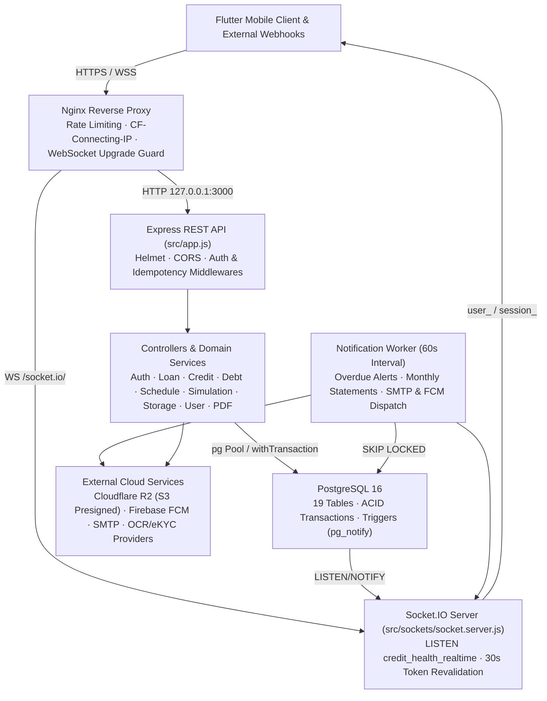

# FinCredit API — Personal Debt Amortization & Credit Health Backend


> **Service Name:** `fincredit-api` (`v1.0.0`) · **Runtime:** Node.js `>=20.0.0` (ES Modules) · **Database:** PostgreSQL 16
>
> **Repositories:** [GitLab Primary](https://gitlab.com/iloveflo/fincredit-api.git) · [GitHub Mirror](https://github.com/iloveflo/Mobile_programming_api.git)

**FinCredit API** is the production backend powering the *FinCredit* Flutter personal finance & credit health mobile application. Built with **Node.js ESM, Express, PostgreSQL, Socket.IO, Firebase Admin SDK, Cloudflare R2, and PDFKit**, it provides ACID-compliant loan amortization, Vietnamese banking & Civil Code compliance validation, real-time database-triggered WebSocket updates, idempotent mutation guards, automated overdue/monthly statement workers, and encrypted financial dossier PDF generation.

---

## Table of Contents

1. [System Architecture & Real-Time Pipeline](#system-architecture--real-time-pipeline)
2. [Core Functional Modules & Business Rules](#core-functional-modules--business-rules)
3. [Security, Rate Limiting & Idempotency](#security-rate-limiting--idempotency)
4. [REST API Reference](#rest-api-reference)
5. [Real-Time Socket.IO & Push Notifications](#real-time-socketio--push-notifications)
6. [PostgreSQL Schema, Triggers & Migrations](#postgresql-schema-triggers--migrations)
7. [Financial Scoring & Amortization Formulas](#financial-scoring--amortization-formulas)
8. [Project Structure & Tech Stack](#project-structure--tech-stack)
9. [Environment Configuration & Local Setup](#environment-configuration--local-setup)
10. [Containerized Deployment (Docker, Nginx & Supervisor)](#containerized-deployment-docker-nginx--supervisor)
11. [Testing & Quality Assurance](#testing--quality-assurance)
12. [GitLab CI/CD Pipeline](#gitlab-cicd-pipeline)

---

## System Architecture & Real-Time Pipeline



> [!IMPORTANT]
> `server.js` enforces a hard startup guard: `JWT_SECRET` must be present, at least 32 characters long, and must not start with `'your_'`. All routes are mounted simultaneously under `API_PREFIX` (default `/api/v1`), `/api`, and `''` for backward-compatible client routing.

---

## Core Functional Modules & Business Rules

### 1. Authentication, OTP 2FA & Session Lifecycle (`auth.service.js`, `auth.controller.js`)
- **Multi-Identifier Login:** Authenticates via `email`, `phone`, or `id_card_number` (`bcryptjs` hash verification).
- **Brute-Force Lockout:** Tracks `failed_login_attempts`; locks account for `15` minutes (`LOCK_DURATION_MINUTES`) after `5` consecutive failures (`MAX_FAILED_LOGIN`).
- **Challenge-Bound 6-Digit OTP:** Supports `REGISTER`, `RESET_PASSWORD`, `TRANSACTION`, and `LOGIN_DEVICE` (triggered automatically when `x-device-name` / `x-platform` has no prior session in `refresh_tokens`). Enforces 60-second resend cooldown, max `5` verification attempts, `120s` default expiry, and `bcrypt`-hashed OTP storage (`10m` JWT challenge token).
- **Refresh Token Rotation & Multi-Device Sessions:** Access tokens (`15m` default) are paired with 48-byte `base64url` refresh tokens stored as SHA-256 hashes in `refresh_tokens` (`30d` when `remember_me = true`, `1d` when `false`, capped at `7d` on refresh rotation). Revoking a session via `DELETE /api/v1/auth/sessions/:sessionId` immediately emits `session_revoked` to room `session_<id>` and disconnects active sockets.

### 2. Loan Management, Rolling Schedules & Vietnamese Legal Compliance (`loan.service.js`, `loan.controller.js`)
- **Rolling Installment Generation:** Creating a loan generates only the **first** unpaid installment (`buildSchedule(...).slice(0, 1)`) in `payment_schedules`. Paying an installment via `markAsPaid` atomically records the payment, decrements `loans.outstanding_amount`, and rolls forward the next `PENDING` installment if debt remains.
- **Vietnam Civil Code Art. 468 Interest Cap:** Non-credit-institution loans (`loan_type = 'OTHER'` without a `lender_name`) are capped at **20%/year** (`CIVIL_MAX_INTEREST_RATE_PCT`); regulated credit-institution/card loans allow up to **100%/year** (`TCTD_MAX_INTEREST_RATE_PCT`).
- **Vietnam Civil Code Art. 296 Shared Collateral & LTV Caps (`MAX_LTV_BY_ASSET_TYPE`):**
  - `REAL_ESTATE`: **80%** (`0.80`) · `VEHICLE`: **70%** (`0.70`) · `SAVINGS`: **95%** (`0.95`) · `OTHER`: **70%** (`0.70`)
  - Supports many-to-many collateral linking via `loan_collaterals` (`priority_order`, `secured_amount`) and prevents total secured debt from exceeding either `asset_value` or `asset_value * max_ltv_ratio`.
- **Unsecured Loan Eligibility (`UNSECURED_LOAN_RULES`):** For unsecured `CONSUMER` / `CREDIT_CARD` loans: `monthly_income >= 3,000,000 VND`, `principal >= 5,000,000 VND`, `max_active_loans < 3`, total unsecured debt $\le \min(\text{monthly\_income} \times 12,\ 500,000,000\text{ VND})$, and projected $\text{DTI} \le 60\%$.
- **Lifecycle Guards:** Paid loans only permit administrative metadata edits (`409` on principal/term/collateral edits); `SETTLED`/`CLOSED` loans block edits (`409`) and purge unpaid schedules.

### 3. Personal Credit Health & Periodic Reports (`credit.service.js`, `credit.controller.js`)
- **Real-Time Recalculation:** Computes `dti_ratio` (using actual next unpaid installment), `ltv_ratio` (using `SUM(DISTINCT asset_value)` to avoid double-counting shared collateral), `credit_utilization` (for `CREDIT_CARD` loans), `on_time_payment_rate`, and `active_loan_count` inside a `FOR UPDATE` user-locked transaction.
- **Periodic Snapshots (`credit_reports`):** Generates `YYYY-MM` or `YYYY-Q[1-4]` reports, rejecting future periods (`400`), periods predating user/loan history (`400`), and duplicate periods (`409`).

### 4. Debt Payoff Optimization & Repayment Simulation (`debt.controller.js`, `simulation.controller.js`)
- **Debt Strategies:** Persists `AVALANCHE` or `SNOWBALL` plans in `debt_strategies`, automatically deactivating (`INACTIVE`) previous active plans when a new plan is applied.
- **What-If Simulations:** Stores reference scenarios (`EXTRA_PAYMENT`, `CHANGE_PAYMENT`, `CHANGE_INTEREST_RATE`, `EARLY_PAYOFF`, `EXTRA_MONTHLY`, `LUMP_SUM`, `REFINANCE`) linked to user-owned loans.

### 5. Cloudflare R2 Direct Storage & Magic-Byte Verification (`r2.js`, `storage.controller.js`)
- **Presigned Upload & Confirmation:** Issues 300s presigned `PUT` URLs (`avatars`, `collaterals` public; `contracts`, `legal-documents`, `ekyc`, `payslips` private).
- **Anti-Spoofing Verification:** `confirmUpload` runs `HeadObjectCommand` (validating existence, `ContentType`, and `MAX_UPLOAD_BYTES` [10 MB default]) and `GetObjectCommand` (`Range: bytes=0-31`) to inspect binary **magic bytes** (`JPEG`, `PNG`, `WEBP`, `PDF`). Spoofed files are immediately deleted from R2.
- **Private View URLs:** Generates 600s presigned `GET` URLs with `ResponseCacheControl: private, max-age=<ttl>`.

### 6. Financial Capability Dossier PDF (`pdf.service.js`)
- Generates a multi-section A4 PDF (`HoSoNangLuc_FinCredit_<userId>.pdf`) using `PDFKit` with bundled Unicode `NotoSans` fonts (`src/assets/fonts/`), `Asia/Ho_Chi_Minh` timestamps, 6 KPI cards, loan & collateral tables, 6-month upcoming schedule, and Circular 09/2020/TT-NHNN & Decree 13/2023/ND-CP compliance notes. Supports both direct binary streaming (`?direct=1`) and private R2 storage with presigned URL delivery.

### 7. Background Notification Worker, FCM Push & HTML Emails (`notification.service.js`, `push.service.js`, `email-templates.js`)
- Runs every `60s` (`startNotificationWorker`) with a re-entrancy guard:
  1. `generateOverdueAlerts`: Creates deduplicated `OVERDUE_ALERT` records for past-due schedules on `ACTIVE`/`OVERDUE` loans.
  2. `generateMonthlyStatements`: Generates `MONTHLY_STATEMENT` email digests on UTC day 1.
  3. `dispatchDueNotifications`: Locks due `PENDING` notifications (`FOR UPDATE OF n SKIP LOCKED`), delivers HTML ledger emails via `nodemailer` and high-priority push payloads via `firebase-admin` (pruning `registration-token-not-registered` tokens), and emits `'notification'` over Socket.IO.

---

## Security, Rate Limiting & Idempotency

- **HTTP Hardening (`src/app.js`):** `helmet({ frameguard: { action: 'deny' } })`, disabled `x-powered-by`, strict `CORS_ORIGIN` enforcement (rejects wildcard `'*'` in `production`), `1mb` JSON/URL-encoded body limits, and configurable `TRUST_PROXY_HOPS`.
- **Multi-Layer Rate Limiting:**
  - **Nginx:** `api_limit` (`20r/s`, `burst=40`) and `auth_limit` (`10r/m`, `burst=5`) keyed on `CF-Connecting-IP` / `$binary_remote_addr`.
  - **Express (`express-rate-limit`):** Global (`300 req / 15m`), Auth (`10 failed req / 5m`, skipping `GET` and `/logout`), and Sensitive Actions (`40 req / 15m` on `/storage/presigned-url` and `/user/ekyc`).
- **PostgreSQL-Backed Idempotency (`idempotency.middleware.js`):**
  - Opt-in via `Idempotency-Key` or `X-Idempotency-Key` (`8–128` chars) on mutating routes.
  - Computes SHA-256 `request_hash` of `req.body` and stores locks in `idempotency_keys` (24h TTL).
  - Replays cached JSON responses with header `Idempotency-Replayed: true`, rejects in-flight duplicates (`409`), rejects body mismatches (`422`), and cleans up locks on premature connection close or `>= 500` errors.
- **SQL Error Normalization (`error.middleware.js`):** Maps PostgreSQL unique violations (`23505` → `409`) and constraint/type errors (`23503`, `23502`, `23514`, `22P02`, etc. → `400`) without leaking internal DB details.

---

## REST API Reference

All routes are mounted under `{prefix}` ∈ `{ API_PREFIX ('/api/v1'), '/api', '' }`.

| Group | Method & Path | Auth / Middlewares | Handler |
|---|---|---|---|
| **Health** | `GET /`, `GET /health` | Public (`SELECT 1` DB probe) | `app.js` |
| **Auth (Public)** | `POST /auth/register`, `POST /auth/verify-otp`, `POST /auth/resend-otp`, `POST /auth/login`, `POST /auth/refresh-token`, `POST /auth/reset-password` | `authLimit`, `requireFields` | `auth.controller.js` |
| **Auth (Protected)** | `GET /auth/session`, `GET /auth/sessions`, `DELETE /auth/sessions/:sessionId`, `POST /auth/logout`, `POST /auth/change-password` | `authenticateToken` | `auth.controller.js` |
| **User & eKYC** | `GET /user/profile`, `PUT /user/profile`, `PUT /user/security-settings`, `GET /user/financial-profile-pdf`, `POST /user/ekyc-verify`, `POST /user/fcm-token`, `DELETE /user/fcm-token` | `authenticateToken`, `idempotency` on mutations | `user.controller.js` |
| **Loans** | `GET /loans`, `POST /loans`, `POST /loans/ocr-scan`, `GET /loans/:loanId`, `PUT /loans/:loanId`, `DELETE /loans/:loanId`, `GET /loans/:loanId/assets`, `GET /loans/:loanId/documents` | `authenticateToken`, `idempotency` on `POST`/`PUT` | `loan.controller.js` |
| **Collaterals** | `GET /collaterals`, `POST /collaterals`, `POST /collaterals/:assetId/link`, `DELETE /collaterals/:assetId` | `authenticateToken`, `idempotency` on `POST` | `loan.controller.js` |
| **Credit Profile** | `GET /credit-profile`, `POST /credit-profile/recalculate` | `authenticateToken`, `idempotency` on `POST` | `credit.controller.js` |
| **Credit Reports** | `GET /credit-reports`, `POST /credit-reports/generate`, `GET /credit-reports/:id`, `DELETE /credit-reports/:id` | `authenticateToken`, `idempotency` on `POST` | `credit.controller.js` |
| **Debt Strategies** | `GET /debt-strategies`, `GET /debt-strategies/active`, `POST /debt-strategies/apply`, `PATCH /debt-strategies/:strategyId/cancel` | `authenticateToken`, `idempotency` on `POST`/`PATCH` | `debt.controller.js` |
| **Schedules** | `GET /payment-schedules`, `GET /payment-schedules/summary`, `POST /payment-schedules/sync`, `GET /payment-schedules/:scheduleId`, `POST /payment-schedules/:scheduleId/pay`, `PUT /payment-schedules/:scheduleId` | `authenticateToken`, `idempotency` on `pay`/`PUT` | `schedule.controller.js` |
| **Notifications** | `GET /notifications`, `DELETE /notifications`, `DELETE /notifications/:id`, `GET /notifications/preference`, `PUT /notifications/preference` | `authenticateToken` | `schedule.controller.js` |
| **Simulations** | `GET /simulations`, `POST /simulations`, `DELETE /simulations/:simulationId` | `authenticateToken`, `idempotency` on `POST` | `simulation.controller.js` |
| **Storage (R2)** | `POST /storage/presigned-url`, `POST /storage/confirm-upload`, `GET /storage/view-url`, `GET /storage/files`, `DELETE /storage/file` | `authenticateToken`, `sensitiveActionLimit`, `requireFields` | `storage.controller.js` |

---

## Real-Time Socket.IO & Push Notifications

- **Socket.IO Authentication (`socket.server.js`):** Validates `socket.handshake.auth.token` against `authenticate()` (verifying JWT + unrevoked `refresh_tokens` row + active/unlocked user). Joins rooms `user_${user_id}` and `session_${session_id}`.
- **Continuous Enforcement:** Schedules auto-disconnect at JWT `exp` and re-validates session status every `30s`.
- **PostgreSQL `LISTEN/NOTIFY` (`db.js`):** `setupRealtimeListener` listens to `credit_health_realtime`, re-authenticates each socket in `user_<owner>`, and emits:
  - `credit_health_update`: Triggered by `INSERT`/`UPDATE`/`DELETE` on `notifications`, `loans`, `payment_schedules`, `payments`, and `credit_profiles`.
  - `notification`: Emitted by `notification.service.js` on balance fluctuations or dispatched `PUSH` notifications.
  - `session_revoked`: Emitted when a user revokes a session, immediately disconnecting target sockets.

---

## PostgreSQL Schema, Triggers & Migrations

`credit_health_db.sql` (821 lines) provisions **19 tables**, **11 secondary indexes**, **2 PL/pgSQL functions**, **10 triggers**, and idempotent seed data (`setval` sequence sync):

- **Tables (19):** `users`, `loan_types`, `loans`, `assets`, `loan_collaterals`, `loan_documents`, `payment_schedules`, `payments`, `credit_profiles`, `credit_reports`, `notifications`, `debt_strategies`, `simulations`, `refresh_tokens`, `otp_verifications`, `notification_preferences`, `storage_uploads`, `idempotency_keys`, `device_tokens`.
- **Triggers (10):**
  - `5 × BEFORE UPDATE` (`update_updated_at_column()`): `users`, `loans`, `loan_documents`, `credit_profiles`, `notification_preferences`.
  - `5 × AFTER INSERT OR UPDATE OR DELETE` (`notify_realtime_event()`): `notifications`, `loans`, `payment_schedules`, `payments`, `credit_profiles`.
- **Migrations (`scripts/migrate.js`):** Executes `.sql` files in `migrations/` inside `withTransaction` protected by `pg_advisory_xact_lock(91827461)` and tracks state in `schema_migrations`.
- **Numeric Precision (`src/config/db.js`):** Configures `pg` type parsers for `DECIMAL` (OID `1700`) and `BIGINT` (OID `20`) to return native JS numbers, and enforces `UTC` (`TIMESTAMP WITHOUT TIME ZONE` parsed as UTC).

---

## Financial Scoring & Amortization Formulas

- **Credit Score (`credit.service.js`):** Returns `null` (`risk_level: 'UNKNOWN'`) if `monthly_income` is missing or any active loan lacks a next unpaid schedule; otherwise computes:

```math
\text{LTV Penalty} = \begin{cases} \min(0.5,\ \text{LTV} - 0.7) \times 100 & \text{if } \text{LTV} > 0.7 \\ 0 & \text{otherwise} \end{cases}
```

```math
\text{Score} = \text{clamp}_{[300,\,850]}\!\left(\text{round}\!\left(850 - \min(\text{DTI}, 2) \times 200 - \text{Utilization} \times 100 - (1 - \text{OnTimeRate}) \times 200 - \text{LTV Penalty}\right)\right)
```

- **Risk Tiers:**
  - `HIGH`: $\text{DTI} > 0.5$ OR $\text{overdue} > 0$ OR $\text{LTV} > 0.85$
  - `MEDIUM`: $\text{DTI} > 0.35$ OR $\text{LTV} > 0.70$
  - `LOW`: Otherwise

---

## Project Structure & Tech Stack

```text
my-api-gitlab/
├── .gitlab-ci.yml                  # 3-stage GitLab pipeline (test -> build -> deploy)
├── Dockerfile                      # node:20-alpine + Nginx + Supervisor + gettext
├── docker-compose.yml              # PostgreSQL 16 + backend container orchestration
├── nginx.conf                      # Reverse proxy template (${PORT}), rate limits, WS guard
├── supervisord.conf                # Process manager (Nginx priority 10, Node priority 20)
├── credit_health_db.sql            # Full 19-table PostgreSQL schema, triggers & seed data
├── migrations/                     # Incremental SQL migrations (tracked by schema_migrations)
├── scripts/
│   ├── check.js                    # Recursive node --check syntax validator
│   ├── migrate.js                  # Advisory-locked SQL migration runner
│   └── seed-dev.js                 # Dev account bcrypt password seeder
├── src/
│   ├── app.js                      # Express app, Helmet, CORS, rate limiters, multi-prefix routes
│   ├── assets/fonts/               # NotoSans-Regular.ttf & NotoSans-Bold.ttf for PDFKit
│   ├── config/                     # constants.js, db.js (Pool + LISTEN/NOTIFY), r2.js (S3/R2)
│   ├── controllers/                # 8 HTTP controllers
│   ├── middlewares/                # auth, error, idempotency, validate
│   ├── models/                     # 16 domain models + index.js barrel
│   ├── routes/                     # 8 route modules
│   ├── services/                   # auth, credit, loan, notification, pdf, provider, push
│   ├── sockets/                    # socket.server.js (Socket.IO auth & room lifecycle)
│   └── utils/                      # api.js, dto.js, email-templates.js
└── test/                           # 3 PGlite integration test suites (46 tests total)
```

### Dependencies (`package.json`)
`express` (`^4.18.2`), `pg` (`^8.11.0`), `socket.io` (`^4.7.0`), `jsonwebtoken` (`^9.0.0`), `bcryptjs` (`^2.4.3`), `helmet` (`^7.0.0`), `cors` (`^2.8.5`), `express-rate-limit` (`^7.0.0`), `firebase-admin` (`^14.5.1`), `nodemailer` (`^10.5.0`), `pdfkit` (`^0.20.2`), `@aws-sdk/client-s3` (`^3.0.0`), `@aws-sdk/s3-request-presigner` (`^3.0.0`), `dotenv` (`^16.0.0`), and devDependency `@electric-sql/pglite` (`^0.5.16`).

---

## Environment Configuration & Local Setup

Copy `.env.example` to `.env` and configure:
- **Server & Security:** `NODE_ENV`, `PORT`, `HOST`, `API_PREFIX`, `CORS_ORIGIN`, `TRUST_PROXY_HOPS`, `JWT_SECRET` (≥32 chars), `JWT_EXPIRES_IN`, `JWT_REFRESH_EXPIRES_IN`, `RATE_LIMIT_*`, `AUTH_RATE_LIMIT_*`.
- **Database:** `DB_HOST`, `DB_PORT`, `DB_USER`, `DB_PASSWORD`, `DB_NAME`, `DB_MAX_CLIENTS`.
- **OTP & Email:** `OTP_EXPIRES_IN_SECONDS`, `OTP_DELIVERY` (`console` in non-prod or SMTP), `SMTP_HOST`, `SMTP_PORT`, `SMTP_SECURE`, `SMTP_USER`, `SMTP_PASS`, `SMTP_FROM`.
- **Cloudflare R2 & Uploads:** `R2_ENDPOINT`, `R2_ACCESS_KEY_ID`, `R2_SECRET_ACCESS_KEY`, `R2_BUCKET_PUBLIC`, `R2_BUCKET_PRIVATE`, `R2_PUBLIC_DOMAIN`, `R2_PRESIGNED_UPLOAD_EXPIRES`, `R2_PRESIGNED_VIEW_EXPIRES`, `MAX_UPLOAD_BYTES`.
- **Push, PDF & External Providers:** `FIREBASE_SERVICE_ACCOUNT_BASE64`, `PDF_FONT_PATH`, `OCR_PROVIDER_URL`, `OCR_PROVIDER_TOKEN`, `EKYC_PROVIDER_URL`, `EKYC_PROVIDER_TOKEN`.

### Local Commands
```bash
# 1. Install dependencies
npm install

# 2. Start PostgreSQL + Backend via Docker Compose
docker compose up -d --build

# 3. Or run locally against an existing PostgreSQL instance
npm run db:migrate
npm run db:seed-dev
npm run dev          # node --watch server.js
```

> [!NOTE]
> `npm run db:seed-dev` hashes `'123456'` with `bcryptjs` for the `dev@test.com` account if it is still stored in plaintext.

---

## Containerized Deployment (Docker, Nginx & Supervisor)

The production `Dockerfile` (`node:20-alpine`) bundles **Nginx**, **Supervisor**, and **Node.js 20** into a single container compatible with **Coolify**, **Render**, and VPS deployments:
1. **`supervisord.conf`:** Launches `nginx` (`priority=10`) after running `envsubst` on `/etc/nginx/nginx.conf.template` to inject `${PORT:-80}`, then starts `backend` (`priority=20`) on `127.0.0.1:3000` running `npm run db:migrate && npm start`.
2. **`nginx.conf`:** Enforces `client_max_body_size 10M`, disables `server_tokens`, applies rate limiting, rejects non-`websocket` `Upgrade` headers on `/socket.io/` (`400` to prevent H2C smuggling), and sets `86400s` WebSocket timeouts.

> [!WARNING]
> Always set `TRUST_PROXY_HOPS=1` (or the appropriate hop count behind Cloudflare/Nginx) in production so `express-rate-limit` evaluates the client IP rather than the proxy address.

---

## Testing & Quality Assurance

All **46 integration tests** run in-memory using `@electric-sql/pglite` loaded directly from `credit_health_db.sql` with serialized query locking and ephemeral HTTP servers (`127.0.0.1:0`):

- `test/api.test.js` (**38 tests**): End-to-end coverage of schedule math, auth/OTP/new-device flows, brute-force locks, loans/collaterals (Civil Code Art. 296 & 468, unsecured rules, rolling schedules, early settlement), credit recalculation & reports, debt strategies, simulations, R2 magic-byte anti-spoofing, PDF export, notifications, and Socket.IO revocation.
- `test/fcm_push.test.js` (**4 tests**): FCM token registration/reassignment/removal, multicast payload formatting, invalid token pruning, and worker push dispatch.
- `test/idempotency.test.js` (**4 tests**): Replay with `Idempotency-Replayed: true`, body-mismatch `422` rejection, invalid key `400` rejection, payment idempotency, and per-user key isolation.

```bash
npm run check   # Syntax check across src/, scripts/, and test/
npm test        # Run all 46 PGlite integration tests
```

---

## GitLab CI/CD Pipeline

Configured in `.gitlab-ci.yml` on runner tag `my-debian-runner`:

1. **`test` (`test_job` — MRs, `main`, `develop`):** Runs `npm ci`, `node --check` on entrypoints and `npm run check`, ES module import smoke checks (`app.js`, `push.service.js`, `pdf.service.js`, `idempotency.middleware.js`), `npm test` (with `credit_health_db.sql`), and non-blocking `npm audit --audit-level=high`.
2. **`build` (`build_job` — `main` only):** Builds Docker image with `docker:24.0.5-dind` using `:latest` cache and pushes `:$CI_COMMIT_SHORT_SHA` and `:latest` to `$CI_REGISTRY_IMAGE`.
3. **`deploy` (`deploy_job` — `main` only):** Triggers `COOLIFY_WEBHOOK_URL` and/or `RENDER_DEPLOY_HOOK_URL` (fails if both fail or neither is configured).
